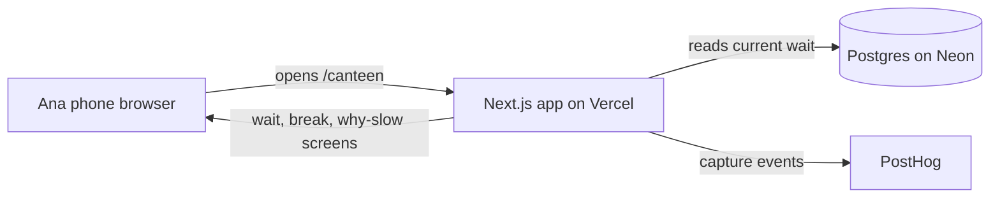

# Architecture

One diagram, one line of why per layer. The question each line answers is not "is this the best technology" but "can this team deploy it at a public URL by the Week 7 lab." The best reason on this page is "someone on this team has deployed this before."

## The diagram

Journey: Ana's phone → our app → where the wait number is stored → PostHog. No messages out in Sprint 1.

One public page on the phone. No staff dashboard and no login in Sprint 1. The wait minutes are a single row we update (manual or scripted for Week 7); students only read.

## The stack, one line per layer

| Layer | Choice | Why we can deploy it by Week 7 (who has done it before, or the free tier that makes it easy) |
|---|---|---|
| Hosting | Vercel | BR (Build) has deployed class projects there; free tier; HTTPS and a public URL in minutes |
| App framework | Next.js (App Router) in `app/` | BR knows React; one deploy for UI and server routes; no separate backend host for Sprint 1 |
| Database | Postgres on Neon | Hosted free tier; nothing to run on a laptop; one `canteen_status` row (minutes, reason, updated_at) is enough |
| Analytics | PostHog (wired from `setup/SHIP-STACK-SETUP.md`) | fixed for the course |
| Messages out (email, SMS, WhatsApp), if any step needs one | None | Sprint 1 only shows a wait number; nothing to send |
| Sign-in, if any step needs one | None | Any student opens `/canteen`; no accounts |

**Layers we deliberately do not have in Sprint 1:** login, staff dashboard, real-time camera/queue counting, food-left status, pre-order/pay, chat, push notifications, WhatsApp API.

## The journey through the stack

Steps match the thin slice we will put in `03-build/mvp-boundary.md` (Ana checks wait and decides). Events are draft names until `event-schema.md` is filled; rename to match that file when it lands.

| Step | Layer that handles it | Event fired |
|---|---|---|
| 1. Ana opens `/canteen` on her phone after lecture | Next.js page on Vercel | `student_opens_canteen` (client) |
| 2. App reads current minutes + last updated from Neon | Next.js server route + Postgres | `student_sees_wait` (client, after render, with `minutes`) |
| 3. She sees wait against her break (food-by vs class time) | Next.js page | `student_sees_break_fit` (client, with `minutes`, `class_at`) |
| 4. She sees why it is slow (e.g. stuck at register) | Next.js page | `student_sees_reason` (client, with `reason`) |
| 5. She decides go / don't go (and we stop; no booking) | Phone + PostHog only | `student_decides` (client, with `decision`: go / skip) — north-star candidate |

## Secrets and data

- Secrets live in: `.env` (`DATABASE_URL`, `NEXT_PUBLIC_POSTHOG_KEY`, `POSTHOG_HOST` if needed). `.gitignore` lists `.env` (confirmed in repo root before any secrets are committed).
- Personal data we store, and where: Sprint 1 stores **no student identity**. Only canteen status fields in Postgres (`minutes`, `reason`, `updated_at`). PostHog events use anonymous distinct ids; never a name, email, or student ID on an event.
- The one thing in this design most likely to break on deploy day: PostHog events not firing on the public URL (wrong project key or adblock). First fix in the Week 7 lab: open `/canteen` on a phone, trigger `student_opens_canteen`, confirm it in the PostHog live view.
